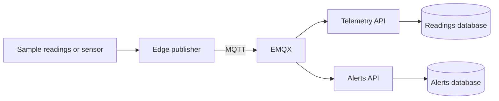

# Machine Telemetry Lab

Two .NET services watch the temperature of a pump. One keeps a history of the readings. The other records an alert when the temperature goes above the limit.



## Try it

Start the backend from this repo with Docker and Compose running.

```sh
docker compose up --build -d
```

With the .NET 10 SDK installed, run the simulator from a second terminal.

```sh
git clone https://github.com/KZTP47/machine-telemetry-edge
cd machine-telemetry-edge
dotnet run --project src/Publisher -- simulate
```

| Open | Look for |
| --- | --- |
| [Readings](http://localhost:5181/readings) | Four readings, including 86 °C |
| [Alerts](http://localhost:5182/alerts) | An alert with the same event ID as the 86 °C reading |

The default limit is 75 °C. A reading of exactly 75 °C stays in the history. From the backend repo, run `docker compose run --build --rm integration` to check that boundary, duplicate delivery and a message on the wrong topic. Run `docker compose down` when you're done. The databases keep their records between runs.

## For juniors and interns

Start with the [illustrated beginner's guide (PDF)](docs/machine-telemetry-beginners-guide.pdf). It follows one temperature reading from the pump to the alert.

Think of a laundry room with a thermometer on a dryer. Every time someone reads it, they write down the dryer number, the time and the temperature. The front desk passes a copy to the person keeping the log and another to maintenance. Maintenance only files a report when the dryer gets too hot.

| Term | What it means here |
| --- | --- |
| IoT and telemetry | IoT stands for Internet of Things. The thermometer is a device connected to a network through the publisher. Telemetry is the stream of readings it sends. In the demo, a program makes up the temperatures. |
| MQTT | The rules for sending readings to a named inbox called a topic. A program can subscribe to a topic to receive new readings. |
| EMQX | The MQTT broker. It's the front desk that passes the reading to both subscribers. |
| Microservices | Two programs with separate jobs. Telemetry saves readings. Alerts checks the limit and saves reports in its own database. |
| C#, .NET 10 and ASP.NET Core | C# is the language the services are written in. .NET 10 runs the code. ASP.NET Core handles the web requests. |
| REST API | A web address where you can ask for information. `GET /readings` asks for the log. `GET /alerts` asks for the reports. |

## Telemetry v1

Send a JSON message with MQTT QoS 1 to `machines/<machine-id>/telemetry`. The machine ID in the topic must match `machineId` in the message.

```json
{
  "id": "e259946d-0afc-4d4b-a447-67c75616af24",
  "machineId": "pump-01",
  "recordedAt": "2026-01-01T12:00:00Z",
  "temperatureC": 86
}
```

Create one UUID for each reading and reuse it if you send that reading again. The services use it to avoid duplicate records.

## Connect a sensor

The [edge publisher](https://github.com/KZTP47/machine-telemetry-edge#use-a-sensor) reads a Linux DS18B20 sensor file. GitHub Actions runs that path with a file that mimics the sensor. The test sends the reading from the separate repo and checks both APIs.

For a publisher on another machine, put `ca.pem`, `server.pem` and `server.key` in a local folder that EMQX can read. Set `MQTT_BROKER_CERT_DIR` to that folder and `EDGE_MQTT_BIND` to the broker's address on the sensor network. The server certificate must match the host name or IP that the publisher uses. Start with both Compose files.

```sh
docker compose -f compose.yaml -f compose.sensor.yaml up --build -d
```

Port 8883 requires a client certificate signed by the CA. The demo MQTT port, 1883, stays on loopback. Set `ALARM_THRESHOLD_C` before starting Compose to change the limit for new alerts.
