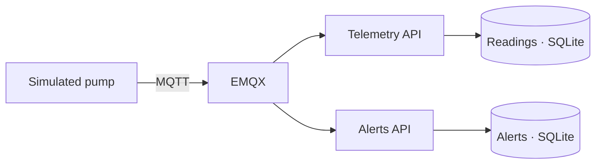

# Machine Telemetry Lab

A simulated pump sends temperature readings over MQTT. Two C# services consume the same readings. The telemetry API stores them, and the alerts API records any reading above 75 °C.



## Run the demo

With Docker and Compose running, execute these commands from the repository root.

```sh
docker compose up --build -d
docker compose run --build --rm simulator
```

The simulator checks four readings and two alerts, including duplicate delivery, an invalid topic and the 75 °C boundary. It prints the event ID for the **86 °C** reading.

| Open in your browser | What you will see |
| --- | --- |
| [Telemetry](http://localhost:5181/readings) | The 86 °C reading alongside ordinary readings |
| [Alerts](http://localhost:5182/alerts) | The same event ID with the 75 °C threshold |

Both APIs return the latest 50 records. The services own separate SQLite databases and use event IDs to deduplicate MQTT deliveries. API ports are bound to localhost. Docker Compose keeps the MQTT broker on the internal network.

Stop the demo with `docker compose down`. The local volumes preserve readings between runs. For a fresh demo, `docker compose down -v` also removes the demo's stored readings.

**Stack** · .NET 10, ASP.NET Core, MQTTnet, EMQX, SQLite and Docker Compose.
